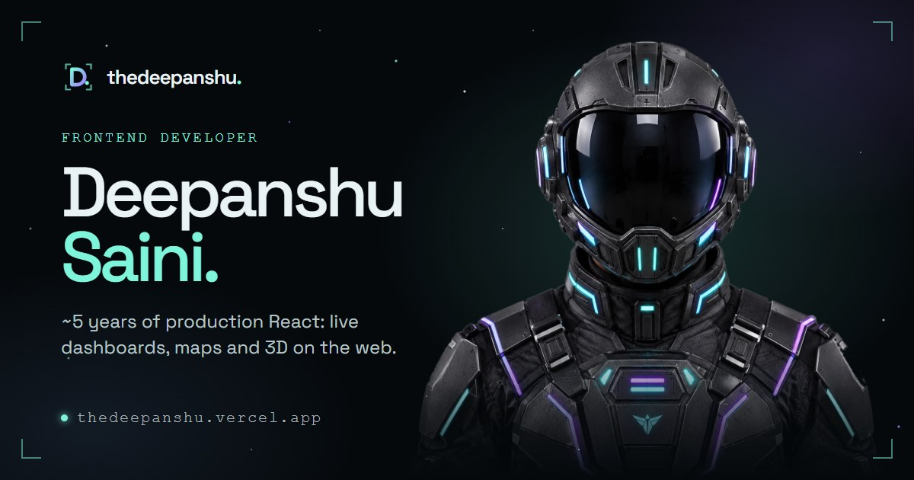

# The Vessel: portfolio of Deepanshu Saini

**Frontend Developer** · Panipat, Haryana, India · [thedeepanshu.vercel.app](https://thedeepanshu.vercel.app)

[](https://github.com/thedeepanshu/thedeepanshu/actions/workflows/ci.yml)



My portfolio is a ship you can explore. Each page is a deck, and moving between pages flies a camera through a real-time WebGL world. Underneath the 3D, every
page is plain, accessible HTML: it reads fine with JavaScript off, with a screen reader, or with reduced motion turned on.

| Deck             | Route       | What's there                                                 |
| ---------------- | ----------- | ------------------------------------------------------------ |
| Bridge           | `/`         | Introduction and the pilot reveal lens                       |
| Pilot dossier    | `/about`    | How I work and what I value                                  |
| Hangar           | `/missions` | Selected work and case studies                               |
| Star map         | `/arsenal`  | Skills across 8 domains                                      |
| Flight path      | `/journey`  | Experience and education                                     |
| Reactor core     | `/lab`      | The WebGL, shader and audio experiments behind the site      |
| Observation deck | `/beyond`   | Off-duty: what I watch, listen to and learn, and our channel |
| Comms array      | `/signal`   | Contact                                                      |

Résumé: [ATS version (PDF)](public/Deepanshu-Saini-Frontend-Developer-Resume.pdf) · [visual version (PDF)](public/Deepanshu-Saini-Frontend-Developer-Resume-Visual.pdf)

## Highlights

- **3D world:** React Three Fiber and three.js, with custom GLSL (starfield, nebula, a 42,000-particle core) and post-processing. Quality drops automatically on slow devices.
- **Sound:** procedural Web Audio ambience and effects. Visitors choose sound or silence when boarding, and can change it at any time.
- **Fast first paint:** every route is prerendered at build time, so the HTML has real content and a static first frame before any JavaScript runs.
- **Accessible:** WCAG 2.2 AA; axe reports 0 violations on every route, on desktop and phone. Full keyboard support, a command palette (Ctrl/⌘ K) and reduced-motion support. See [docs/ACCESSIBILITY.md](docs/ACCESSIBILITY.md).
- **Search-ready:** per-page titles, descriptions, canonical and Open Graph tags, JSON-LD (Person, WebSite, ProfilePage, breadcrumbs, projects), a sitemap, and real 404s.
- **Secure:** strict Content Security Policy (no inline scripts), HSTS and the other security headers, and `security.txt`.
- **Tested:** unit tests (Vitest), end-to-end and accessibility tests on every route (Playwright + axe), Lighthouse CI, and a bundle size budget enforced at build.

## Tech stack

React 19 · TypeScript (strict) · Vite 8 · React Router 7 · React Three Fiber 9 / three.js · zustand · Web Audio · Vitest · Playwright · ESLint · Prettier · Vercel

## Run it locally

Requires Node 22 (see `.nvmrc`).

```bash
npm ci
npm run dev        # http://localhost:5173
```

| Command            | What it does                                                                |
| ------------------ | --------------------------------------------------------------------------- |
| `npm run build`    | Typecheck, build, prerender every route, write SEO files, check size budget |
| `npm run preview`  | Serve the production build                                                  |
| `npm run check`    | Typecheck, lint, format check, unit tests                                   |
| `npm run test:e2e` | Playwright + axe on every route (run `npm run build` first)                 |
| `npm run resume`   | Regenerate both résumé PDFs from `resume-source/`                           |

Configuration lives in `.env` (see [.env.example](.env.example)). `VITE_SITE_URL` sets the site's address for canonical URLs, the sitemap, structured data and
links.

## Documentation

- [Architecture](docs/ARCHITECTURE.md): how the pages, the 3D world, prerendering and SEO fit together
- [Accessibility](docs/ACCESSIBILITY.md): results and how to re-run the checks
- [SEO](docs/SEO.md): what's in place and how to validate it
- [Manual steps](docs/MANUAL_STEPS.md): things that need a person (dashboards, accounts, domain)
- [Contributing](CONTRIBUTING.md) · [Changelog](CHANGELOG.md) · [Security](SECURITY.md)

## Licence

The **code** is [MIT licensed](LICENSE). My name, photos, résumé, written content and personal media are **not** covered by that licence; please don't reuse
them.

## Contact

[deepanshusaini971@gmail.com](mailto:deepanshusaini971@gmail.com) · [LinkedIn](https://www.linkedin.com/in/deepanshu-saini-a97229206/) ·
[GitHub](https://github.com/thedeepanshu)
